# Actors

<!-- Generated by specgate from docs/brief.md's actors and each requirement's actor=.
     Do not edit: `specgate check` rewrites it, and `validate` reports a copy that differs. -->

```mermaid
flowchart LR
  actor_Developer(["Developer"])
  actor_Reviewer(["Reviewer"])
  cap_build_live["build-live"]
  cap_core_host["core-host"]
  cap_editor["editor"]
  cap_help["help"]
  cap_project_setup["project-setup"]
  cap_questions["questions"]
  cap_specgate_port["specgate-port"]
  cap_terminal["terminal"]
  cap_workspace["workspace"]
  req_REQ_001["REQ-001 — One core host per open project, over typed JSON-RPC"]
  req_REQ_002["REQ-002 — The project's state kept in memory after the first read"]
  req_REQ_003["REQ-003 — A changed file refreshes only what it feeds"]
  req_REQ_004["REQ-004 — A section's data in under 50 ms after the first read"]
  req_REQ_005["REQ-005 — A command followed as events"]
  req_REQ_006["REQ-006 — One write command at a time"]
  req_REQ_007["REQ-007 — Arguments as an array, never a shell"]
  req_REQ_011["REQ-011 — The core knows specgate only through SpecgatePort"]
  req_REQ_012["REQ-012 — The CLI adapter: specgate with --json, parsed"]
  req_REQ_013["REQ-013 — The installed specgate checked at start"]
  req_REQ_014["REQ-014 — The in-process adapter, once specgate publishes its API"]
  req_REQ_015["REQ-015 — One contract test suite for every adapter"]
  req_REQ_016["REQ-016 — A command the port does not offer is refused before anything runs"]
  req_REQ_021["REQ-021 — An opened folder is told empty, code, or a specgate project"]
  req_REQ_022["REQ-022 — The watcher ignores dependencies, git and build output"]
  req_REQ_023["REQ-023 — The watcher keeps up with 50,000 files"]
  req_REQ_024["REQ-024 — The branch, and the team and ticket it names"]
  req_REQ_025["REQ-025 — The uncommitted files, grouped by folder"]
  req_REQ_026["REQ-026 — The last 10 projects of each Developer"]
  req_REQ_041["REQ-041 — The editor loads when the first file opens, not before"]
  req_REQ_042["REQ-042 — Build, Check, Trace, Ask for a change and '?' above each requirement"]
  req_REQ_043["REQ-043 — Findings underlined where they are, with their fix"]
  req_REQ_044["REQ-044 — A blocking question inline under its requirement, for the Reviewer"]
  req_REQ_045["REQ-045 — Saving writes the file, and nothing else is written without the person"]
  req_REQ_051["REQ-051 — A terminal in the project's folder, with the Developer's shell"]
  req_REQ_052["REQ-052 — The same terminal on macOS, Windows and Linux"]
  req_REQ_053["REQ-053 — A command the studio runs is echoed with the button that started it"]
  req_REQ_054["REQ-054 — What the studio echoes is shown, never typed into the Developer's shell"]
  req_REQ_055["REQ-055 — Several terminals at once"]
  req_REQ_056["REQ-056 — Each terminal keeps its scrollback"]
  req_REQ_061["REQ-061 — A '?' beside every feature that acts, for the Developer"]
  req_REQ_062["REQ-062 — The '?' beside Ask for a change, for the Reviewer"]
  req_REQ_063["REQ-063 — The notice when an action ends names what happened and the next step"]
  req_REQ_064["REQ-064 — After Ask for a change, the Reviewer is told the draft has not changed yet"]
  req_REQ_065["REQ-065 — Every explanation in English and Spanish, or the tests fail"]
  req_REQ_091["REQ-091 — Every open question in one place, with what it blocks"]
  req_REQ_092["REQ-092 — An answer is written to its row, and the requirement stays blocked"]
  req_REQ_093["REQ-093 — 'The spec says it' marks the answer reviewed and lifts Needs Clarification"]
  req_REQ_101["REQ-101 — Build lists what is ready, its estimate and who codes"]
  req_REQ_102["REQ-102 — Build waits on uncommitted work and offers commit, stash or ignore"]
  req_REQ_103["REQ-103 — Live shows each step, the agent's output, the queue, cost and tokens"]
  req_REQ_104["REQ-104 — The agent's question is answered inside Live"]
  req_REQ_105["REQ-105 — Stop after this requirement, or now after a confirmation"]
  req_REQ_111["REQ-111 — An empty folder: five questions, then `specgate init`"]
  req_REQ_112["REQ-112 — A folder with code: adopted in place after a preview"]
  req_REQ_113["REQ-113 — The preview names the settings adoption saves"]
  req_REQ_114["REQ-114 — After setup, what is ready and what is not"]
  req_REQ_115["REQ-115 — The areas adoption found are a map, not requirements"]
  req_REQ_116["REQ-116 — Home leads to the setup the folder needs"]
  actor_Developer --> cap_core_host
  cap_core_host --> req_REQ_001
  cap_core_host --> req_REQ_002
  cap_core_host --> req_REQ_003
  cap_core_host --> req_REQ_004
  cap_core_host --> req_REQ_005
  cap_core_host --> req_REQ_006
  cap_core_host --> req_REQ_007
  actor_Developer --> cap_specgate_port
  cap_specgate_port --> req_REQ_011
  cap_specgate_port --> req_REQ_012
  cap_specgate_port --> req_REQ_013
  cap_specgate_port --> req_REQ_014
  cap_specgate_port --> req_REQ_015
  cap_specgate_port --> req_REQ_016
  actor_Developer --> cap_workspace
  cap_workspace --> req_REQ_021
  cap_workspace --> req_REQ_022
  cap_workspace --> req_REQ_023
  cap_workspace --> req_REQ_024
  cap_workspace --> req_REQ_025
  cap_workspace --> req_REQ_026
  actor_Developer --> cap_editor
  cap_editor --> req_REQ_041
  cap_editor --> req_REQ_042
  cap_editor --> req_REQ_043
  actor_Reviewer --> cap_editor
  cap_editor --> req_REQ_044
  cap_editor --> req_REQ_045
  actor_Developer --> cap_terminal
  cap_terminal --> req_REQ_051
  cap_terminal --> req_REQ_052
  cap_terminal --> req_REQ_053
  cap_terminal --> req_REQ_054
  cap_terminal --> req_REQ_055
  cap_terminal --> req_REQ_056
  actor_Developer --> cap_help
  cap_help --> req_REQ_061
  actor_Reviewer --> cap_help
  cap_help --> req_REQ_062
  cap_help --> req_REQ_063
  cap_help --> req_REQ_064
  cap_help --> req_REQ_065
  actor_Reviewer --> cap_questions
  cap_questions --> req_REQ_091
  cap_questions --> req_REQ_092
  cap_questions --> req_REQ_093
  actor_Developer --> cap_build_live
  cap_build_live --> req_REQ_101
  cap_build_live --> req_REQ_102
  cap_build_live --> req_REQ_103
  cap_build_live --> req_REQ_104
  cap_build_live --> req_REQ_105
  actor_Developer --> cap_project_setup
  cap_project_setup --> req_REQ_111
  cap_project_setup --> req_REQ_112
  cap_project_setup --> req_REQ_113
  cap_project_setup --> req_REQ_114
  cap_project_setup --> req_REQ_115
  cap_project_setup --> req_REQ_116
```

| Actor | Requirements |
| --- | --- |
| Developer | REQ-001, REQ-002, REQ-003, REQ-004, REQ-005, REQ-006, REQ-007, REQ-011, REQ-012, REQ-013, REQ-014, REQ-015, REQ-016, REQ-021, REQ-022, REQ-023, REQ-024, REQ-025, REQ-026, REQ-041, REQ-042, REQ-043, REQ-045, REQ-051, REQ-052, REQ-053, REQ-054, REQ-055, REQ-056, REQ-061, REQ-063, REQ-065, REQ-101, REQ-102, REQ-103, REQ-104, REQ-105, REQ-111, REQ-112, REQ-113, REQ-114, REQ-115, REQ-116 |
| Reviewer | REQ-044, REQ-062, REQ-064, REQ-091, REQ-092, REQ-093 |
